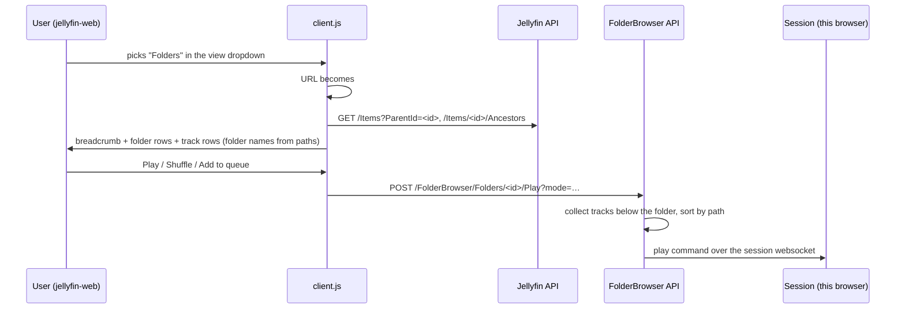

# Jellyfin Folder Browser

A Jellyfin plugin that adds a **Folders** view to music libraries in the web client, so you can browse a
library by the folders on disk: library root → artist or genre folders → release → disc folders → tracks.
You can play, shuffle or queue any level.

Target: **Jellyfin 12.2** (server and the bundled web client). No fork of jellyfin-web is needed.

## Features

- **Folders** entry in the music library's view dropdown, next to Albums, Artists and the others.
- **Real folder structure:**
  - names are the folder and file names on disk, not tags, so you see `Artist - Title (2020)` rather than the
    album tag;
  - disc and bonus folders inside a release (`Disc 1/`, `Bonus/`) appear as folders. Jellyfin itself lists all
    of a release's tracks as one flat album;
  - intermediate folders that Jellyfin labels as artists still open as folders.
- **Folder order:** tracks first, then subfolders, with numbers in numeric order (`Disc 2` before `Disc 10`).
  Playback uses the same order.
- **Breadcrumb navigation**, and every level is a browser history entry, so **Back** goes up one level and
  links to a folder can be bookmarked.
- **Actions:**

  | Where | Actions |
  |---|---|
  | Toolbar | Play all, Shuffle and Add to queue for the current folder |
  | Folder rows | Play, Add to queue; albums also have **Open album page**, plus **Move or delete folder** when Folder Sorter is installed |
  | Track rows | Click to play the folder from that track; Add to queue |

- **Optional Folder Sorter integration:** if the
  [Folder Sorter](../jellyfin-plugin-foldersorter) plugin is installed, album rows you are allowed to delete get
  a **Move or delete folder** button (`drive_file_move` icon). It opens Folder Sorter's *Move to …* /
  *Delete folder* menu, and the list refreshes after a successful move or delete.
  - Without Folder Sorter the button is simply not shown; nothing else changes.
  - The button is only on album rows. Folder Sorter works on whole releases, so it isn't offered for plain
    folders, disc/bonus subfolders or single tracks.
  - The album page's ⋮ menu also has Folder Sorter's entries, as everywhere else.

## How it works



There are two parts:

- **Client side:** a script that File Transformation adds to `index.html`, like in Folder Sorter. It adds
  the view entry and draws the folder list on the normal music library page.
- **Server side:** an endpoint that builds the track list for a folder, in folder order, and sends it to the
  caller's own web session as a play command.

The server part is needed for two reasons:

- Jellyfin's own folder playback orders tracks by title.
- A browser can only send a limited number of track IDs in a request.

Listing a folder uses Jellyfin's standard `/Items` API, so library permissions apply as usual.

Disc and bonus folders aren't separate items in Jellyfin. The script rebuilds them from the track paths
and addresses them as the album's ID plus a relative path (`sub=Disc 1`).

## Requirements

| Component | Version | Notes |
|---|---|---|
| Jellyfin server | 12.2 | Built against `Jellyfin.Controller`/`Jellyfin.Model` 12.2.0. Other 12.x releases are untested. 13.x is not supported. |
| File Transformation plugin | 3.0.3.0 (12.2 build) | Needed to add the script. It can be shared with Folder Sorter. |
| .NET SDK | 10.0 | Only on the machine you build on. |

The view only exists in the Jellyfin web client, in its default (modern) layout. Native apps such as
Finamp, Swiftfin and Findroid don't show it.

## Installation

1. Install **File Transformation** if it isn't installed yet:
   1. Add the repository `https://www.iamparadox.dev/jellyfin/plugins/manifest.json` under
      **Dashboard → Plugins → Repositories**.
   2. Install File Transformation and restart.
2. Build:

   ```sh
   cd Jellyfin.Plugin.FolderBrowser
   dotnet publish -c Release -o ../publish/FolderBrowser_1.0.0.0
   ```

3. Copy `FolderBrowser_1.0.0.0` into the server's `plugins` directory, next to `FileTransformation_*`.
   Make it writable by the user Jellyfin runs as, then restart Jellyfin:

   ```sh
   scp -r ../publish/FolderBrowser_1.0.0.0 you@server:/tmp/
   # on the server (Debian/Ubuntu package layout; Docker: the plugins folder under the /config mount)
   sudo mv /tmp/FolderBrowser_1.0.0.0 /var/lib/jellyfin/plugins/
   sudo chown -R jellyfin:jellyfin /var/lib/jellyfin/plugins/FolderBrowser_1.0.0.0
   sudo systemctl restart jellyfin
   ```

4. Check the server log for:

   ```
   Loaded plugin: Folder Browser 1.0.0.0
   Registered the Folder Browser index.html transformation with File Transformation.
   ```

5. **Hard-refresh** the browser (Cmd+Shift+R / Ctrl+Shift+R). It may still have the old `index.html`
   without the script.

To update, replace the folder's contents and restart. To uninstall, delete the folder and restart.

## Usage

1. Open a music library.
2. Click the view title (**Albums ▾**) and choose **Folders**.
3. Click a folder row to open it, or a breadcrumb to jump back up.
4. Click **Folders ▾** in the toolbar to return to the library's normal views.

## HTTP API

| Method | Path | Result |
|---|---|---|
| `GET` | `/FolderBrowser/client.js` | The injected script (anonymous, `Cache-Control: no-cache`). |
| `POST` | `/FolderBrowser/Folders/{id}/Play` | `204`. Plays the tracks below a folder on the caller's session. |

Parameters of the `Play` endpoint:

| Parameter | Default | Meaning |
|---|---|---|
| `mode` | `PlayNow` | `PlayNow`, `PlayNext` or `PlayLast`. |
| `shuffle` | `false` | Shuffle the tracks. Only applies to `PlayNow`. |
| `startItemId` | | Track to start at, for `PlayNow` without shuffle. |
| `subPath` | | `/`-separated subfolder below the item's folder, for disc and bonus folders. |

Errors:

| Status | Meaning |
|---|---|
| `400` | Invalid `mode` or `subPath`. |
| `404` | The folder doesn't exist, or contains no tracks. |
| `409` | No active session for the calling device. |

## Project structure

```
Jellyfin.Plugin.FolderBrowser/
├── Jellyfin.Plugin.FolderBrowser.csproj   net10.0; Jellyfin 12.2.0 packages (compile-only)
├── Plugin.cs                              Plugin entry point and id
├── PluginServiceRegistrator.cs            Registers the File Transformation registrar
├── Configuration/PluginConfiguration.cs   Empty (no settings yet)
├── Api/FolderBrowserController.cs         client.js and the Play endpoint
├── Services/
│   ├── FolderOrder.cs                     Path comparer: files before subfolders, numeric-aware names
│   ├── FileTransformationRegistrar.cs     Registers the index.html patch with File Transformation
│   └── IndexHtmlPatcher.cs                Adds the <script> tag before </body>
└── Web/client.js                          View-menu entry, folder view, playback buttons (embedded)
```

`client.js` depends on these parts of jellyfin-web 12.2's modern layout:

- the music library route `#/music?topParentId=…`;
- the page element `#musicPage`;
- the view dropdown `#library-view-menu` and its button `button[aria-controls="library-view-menu"]`, which
  sits in an MUI toolbar in the app header;
- the global `ApiClient`.

While the folder view is open, the library's own content and toolbar are hidden with CSS (`:has()`).

## Known limitations

- **300-track cap:** the web client loads at most 300 tracks from a play command.
  - Playing a larger folder queues its first 300 tracks.
  - Shuffling a larger folder queues a random 300.
  - Starting from a track beyond the 300th queues from that track onward.
- **Library root spanning several media folders:** the root level shows the merged contents of all of them.
- **Only the music library view gets a Folders entry.** The legacy layout isn't supported.
- **No ⋮ item menu on the folder rows.** Use **Open album page** to get the album's full ⋮ menu.
